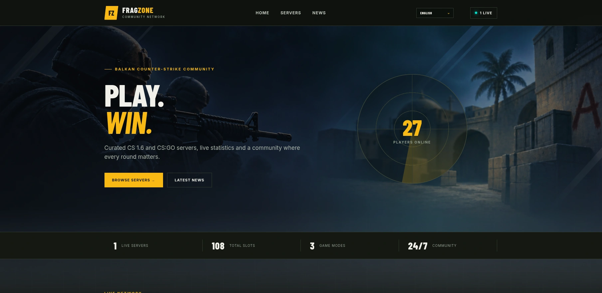

# FragZone

[Български](README.md) | [English](README.en.md)

FragZone is a self-hosted Laravel Blade portal for Counter-Strike 1.6 and CS:GO communities. It provides a fast public server browser, live Valve A2S data and a simple administration panel.

## Features

- Live server status, maps, players, rankings and featured servers
- Server categories, news and bilingual BG/EN content
- Administration for servers, categories, news, SEO and branding
- Extensible Blade theme system
- Docker, Nginx, MariaDB, Redis and PHPUnit support

## Documentation

Setup, deployment, configuration and developer guides are available in the [full documentation](docs/en/README.md).

## Support the project

If FragZone is useful to your server or community, you can support its continued development:

- [Buy Me a Coffee](https://buymeacoffee.com/interweb.bg)
- [Ko-fi](https://ko-fi.com/interwebltd)
- [PayPal](https://paypal.me/interwebltd)
