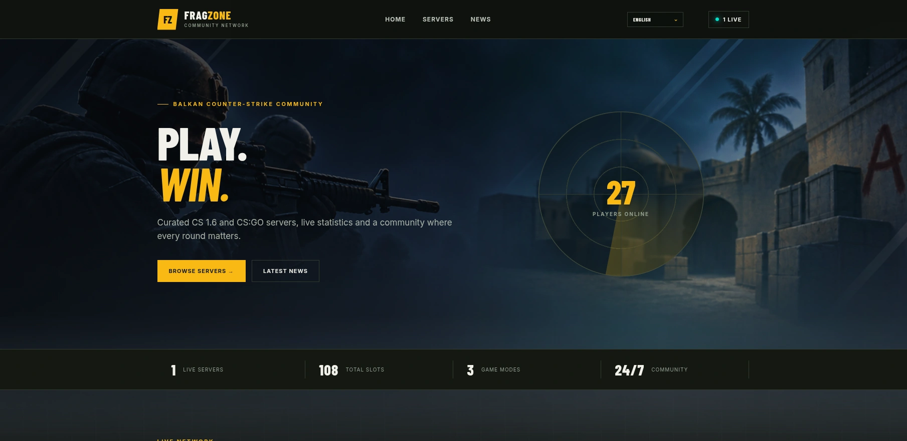

# FragZone

[Български](README.md) | [English](README.en.md)

FragZone е self-hosted Laravel Blade портал за Counter-Strike 1.6 и CS:GO общности. Той предлага бърз публичен списък със сървъри, live Valve A2S данни и удобен административен панел.

## Възможности

- Live статус на сървъри, карти, играчи, класации и препоръчани сървъри
- Категории, новини и двуезично BG/EN съдържание
- Администрация на сървъри, категории, новини, SEO и брандинг
- Разширяема система за Blade теми
- Поддръжка на Docker, Nginx, MariaDB, Redis и PHPUnit

## Документация

Ръководствата за инсталация, deployment, конфигурация и разработка са налични в [пълната документация](docs/README.md).

## Подкрепете проекта

Ако FragZone е полезен за вашия сървър или общност, можете да подкрепите неговата поддръжка и развитие:

- [Buy Me a Coffee](https://buymeacoffee.com/interweb.bg)
- [Ko-fi](https://ko-fi.com/interwebltd)
- [PayPal](https://paypal.me/interwebltd)
